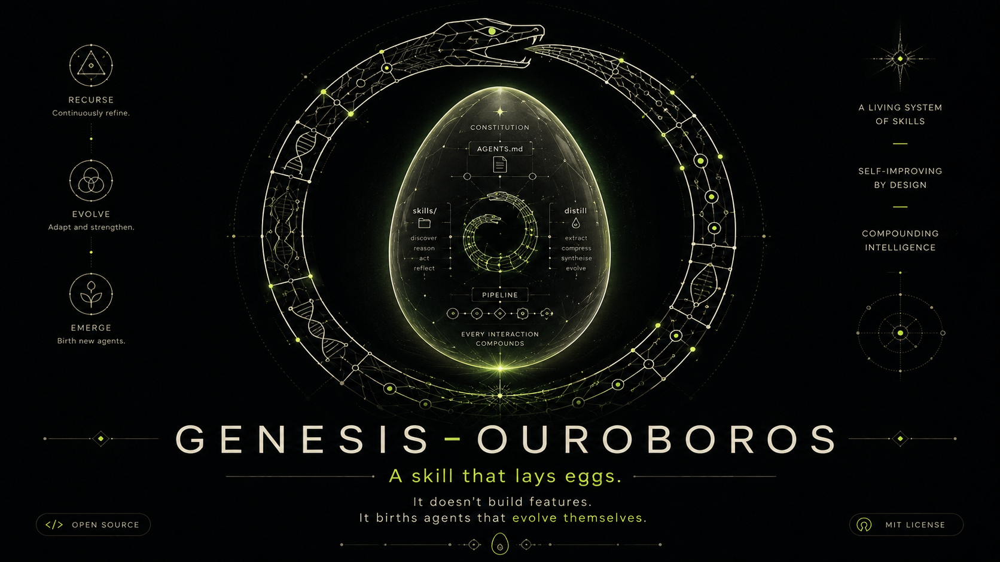
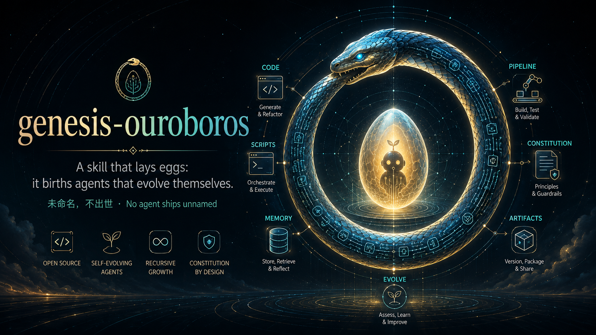
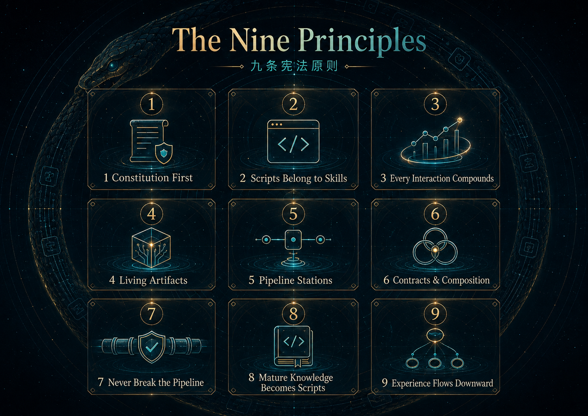
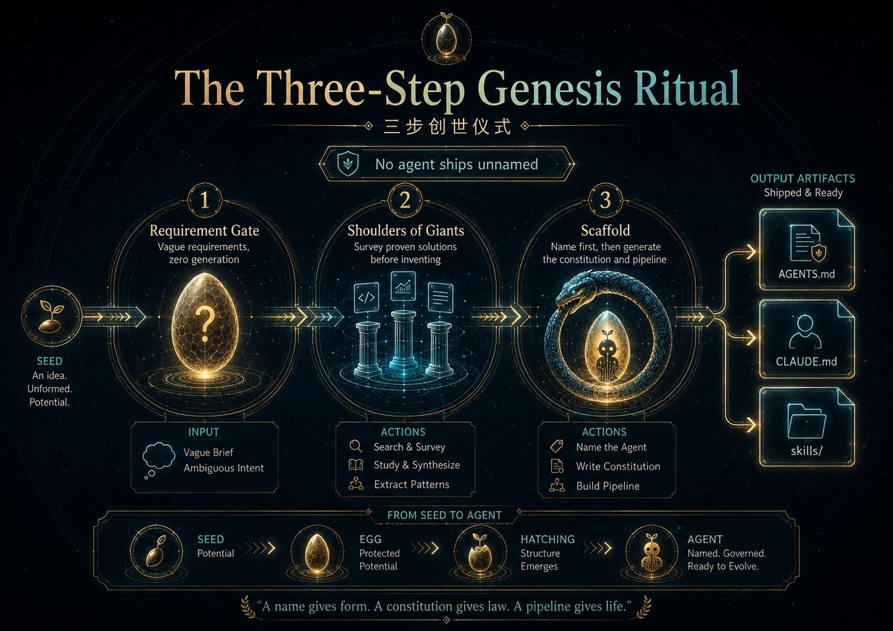

# genesis-ouroboros

> 一个会下蛋的 skill：它不生成功能，它生下会自我进化的 agent。
> A skill that lays eggs: it doesn't build features — it births agents that evolve themselves.

> 🐍 **GitHub:** https://github.com/LuckyZ10/genesis-ouroboros  ·  `git clone https://github.com/LuckyZ10/genesis-ouroboros.git`



---

## 这个故事从哪来 / Origin Story

这个 skill 诞生于一份手写的踩坑笔记。作者在创建了很多个 agent 之后，发现了同样的模式一再重演：

- 宪法文件（`CLAUDE.md` / `AGENTS.md`）越写越臃肿，最后变成没人读的垃圾场；
- 脚本散落一地，没人记得哪个脚本是干什么的；
- 每次会话学到的经验，随着会话结束一起蒸发；
- 修一个新需求，顺手弄坏了三个老功能。

于是这些教训被提炼成了**九条宪法原则**和**三环执行机制**，装进一个"创世 skill"——以后每要创建新 agent，不再从零拍脑袋，而是让这套宪法去接生。

名字里的 **ouroboros（衔尾蛇）** 是古老的循环重生符号：蛇咬住自己的尾巴，不断吞食自己、再生自己。这正是这套设计的灵魂——**agent 的每次交互都在沉淀经验，经验固化成脚本，脚本让下一次交互更强；而沉淀的冗余又被吞噬循环回收**。自我滋养，生生不息。

This skill was born from a handwritten list of hard-earned lessons. After creating many agents, the same failure modes kept repeating: bloated constitution files, orphan scripts everywhere, experience evaporating at the end of every session, and new features breaking old ones. Those lessons were distilled into **Nine Principles** and **Three Rings** — a genesis skill so every new agent is born with a constitution *and the machinery to enforce it*, instead of chaos. The **ouroboros** — the ancient serpent devouring and regenerating itself — captures the soul of the design: every interaction feeds the agent's own evolution, and the devour loop recycles what no longer serves it.



## 命名铁律 / The Naming Iron Law

> 未命名，不出世。/ No agent ships unnamed.

每个 agent 出世前，必先被**赐名**——一个功能契合、有神话重量的名字，就像 *ouroboros*（衔尾蛇）本身。名字要让人一眼嗅出这个 agent 是干什么的，取自神话、宇宙学、炼金术、生物或物理，一两个词、一个能一句话讲完的故事（吞噬数据的 agent 可以叫 *Leviathan*，防御型的可以叫 *Aegis*）。名字将成为 `AGENTS.md` 的第一行。

Every agent is **christened before it is born** — a function-fitting, mythically charged name, the way *ouroboros* names itself. Drawn from myth, cosmology, alchemy, biology, or physics; one or two words with a story behind them (a data-devouring agent might be *Leviathan*, a defensive one *Aegis*). The name becomes the title line of `AGENTS.md`.



---

## 九条宪法原则 / The Nine Principles

宪法只定义 **"应该做什么"**。/ The constitution defines *what to do*.

| # | 原则 | Principle |
|---|------|-----------|
| 1 | 宪法至上：AGENTS.md 只放永恒原则 | Constitution First |
| 2 | 脚本皆有所属：没有孤儿脚本 | Scripts Belong to Skills |
| 3 | 每次交互都要沉淀（可配置 `distill_mode`） | Every Interaction Compounds |
| 4 | skill 与脚本是活的，持续进化 | Living Artifacts |
| 5 | skill 是流水线站点，边界清晰 | Pipeline Stations |
| 6 | 站点有契约（输入/输出），配合可组合 | Contracts and Composition |
| 7 | 进化绝不破坏流水线，向后兼容 | Never Break the Pipeline |
| 8 | 成熟的经验固化为脚本 | Mature Knowledge Becomes Scripts |
| 9 | 经验向下沉淀，不进宪法 | Experience Flows Downward |



---

## 三环执行机制 / The Three Rings

九条宪法告诉 agent "应该做什么"，但缺少让宪法真正闭环的齿轮。三环补全了 **"怎么做到"**。/ The Nine Principles define *what to do*. The Three Rings complete *how to enforce it*.

| 环 | 名称 | 作用 | 对应宪法 |
|---|------|------|---------|
| 🔵 | **第一环 · 沉淀门控** Gated Distillation | 经验写入前过两道门：行为验证（具体改变哪个站点的哪行输出）+ 查重（相似度 > 70% 合并而非新增） | 强化原则 3 |
| 🟠 | **第二环 · 吞噬循环** Devour Loop | 每 N 次运行后自检：合并重复 lesson、删除已被取代的旧规则、修契约表、清孤儿脚本。**真正的衔尾蛇会吃掉自己的尾巴。** | 补全原则 4 & 9 |
| 🔴 | **第三环 · 仲裁优先级** Conflict Arbitration | 当原则冲突时：**流水线完整性 > 向外兼容 > 经验沉淀 > 新功能** | 补全原则 7 |

> **进化不是无限堆积，是有能力丢弃。**
> *Evolution isn't infinite accumulation — it's the capacity to discard.*

详见 SKILL.md 末尾「三环结构」章节。

---

## 三步创世仪式 / The Three-Step Genesis Ritual

1. **需求澄清门** — 需求不清，一行代码不生。先问清楚领域、任务、边界。
2. **站在巨人肩膀上** — 先调研成熟方案与现成 skill，能借力的绝不重造。
3. **生成脚手架** — 先按**命名铁律**为 agent 赐名，再交付 `AGENTS.md`（宪法，首行即代号）+ `CLAUDE.md`（一行 `@AGENTS.md` 引用，Claude 家族同源共治）+ `skills/`（流水线站点）。


---

## 安装 / Installation

把 skill 文件夹复制到你的 Codex skills 目录：

```powershell
# Windows
Copy-Item -Recurse genesis-ouroboros "$env:USERPROFILE\.codex\skills\"
```

```bash
# macOS / Linux
cp -r genesis-ouroboros ~/.codex/skills/
```

或者从 GitHub 下载 / 克隆：

```bash
git clone https://github.com/LuckyZ10/genesis-ouroboros.git
```

或一键安装：

```
$skill-installer install from LuckyZ10/genesis-ouroboros
```

## 用法 / Usage

```
$genesis-ouroboros 帮我创建一个数据分析领域的 agent
```

它会先跟你确认需求、调研现有方案，确认后才生成立宪脚手架。也兼容 Claude Code——生成物中的 `CLAUDE.md` 会自动引用同一份宪法。

## 仓库结构 / Repository Layout

```
genesis-ouroboros-repo/
├── README.md                  # 你正在读的这个故事
├── LICENSE                    # MIT
├── assets/                    # README 配图 / README illustrations
└── genesis-ouroboros/         # 可安装的 skill 本体
    ├── SKILL.md               # 中英双语创世指令（九条原则 + 三环机制 + 运行细则）
    └── agents/openai.yaml     # Codex UI 元数据
```

## 它会如何进化 / How It Evolves

这个 skill 自己也遵守自己的宪法：每次使用中发现的好模式，都应该通过三环机制沉淀回这个仓库——先过门控、再查重、最后经吞噬循环回收冗余。欢迎 issue 和 PR——让衔尾蛇继续转。

This skill obeys its own constitution: patterns discovered in real use flow through the Three Rings — gated distillation, dedup, and the devour loop — back into this repo. Issues and PRs welcome — keep the serpent turning.

## License

MIT
